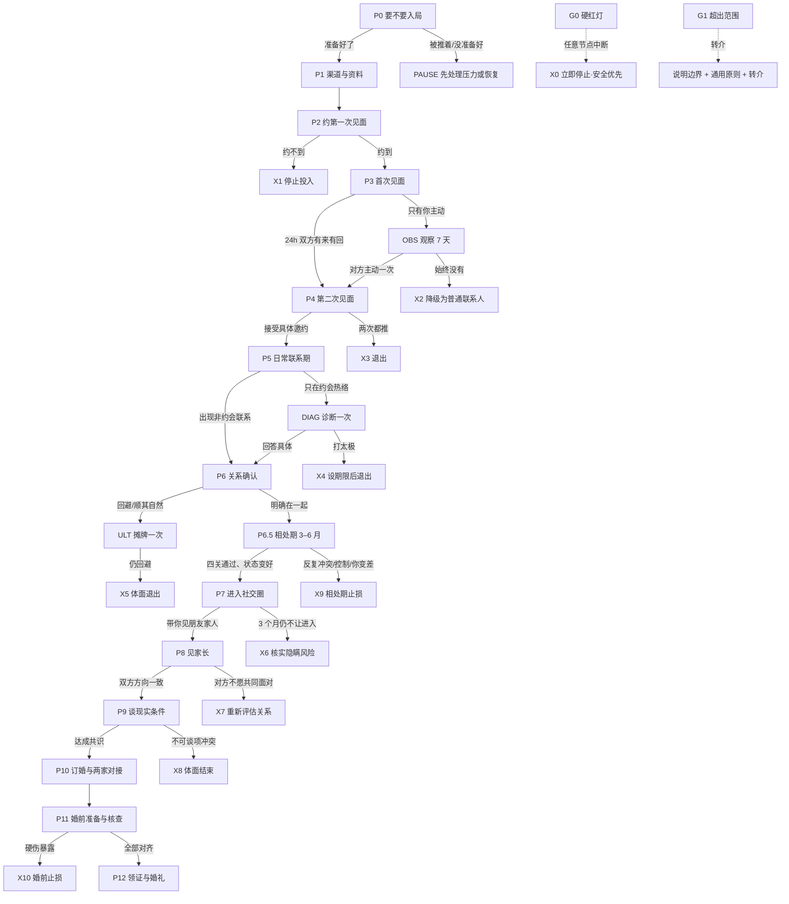

# 决策树：每个节点出现什么，下一步做什么

这份文件是可执行的流程，不是判断标准。判据（这算什么灯）在 `traffic-lights.md`，话术在对应参考里。

**用法**：先按「入口定位」找到用户当前所在节点，然后只读那个节点的卡片，给出**唯一一个默认动作**，不要一次抛五个选项。

## 入口定位

| 用户说的话 | 从哪个节点进 |
|---|---|
| 「要不要相亲」「被家里逼着来的」「刚分手就被安排」 | P0 |
| 「没人介绍」「见不到人」「资料怎么写」 | P1 |
| 「约不出来」「说了几次都没定时间」 | P2 |
| 「刚见完第一次，不知道有没有戏」 | P3 |
| 「约了第二次，但感觉不对」 | P4 |
| 「天天聊天，但就是不推进」 | P5 |
| 「处了两个月，还没确定关系」 | P6 |
| 「确定关系了，但老吵架/看不透他」 | P6.5 |
| 「他不让我见他朋友/家人」 | P7 |
| 「要不要见家长」「家里不同意」 | P8 |
| 「彩礼/房子/异地谈不拢」 | P9 |
| 「要订婚了」「婚前要查什么」 | P10 → P11 |
| 二婚带娃、年龄差、异地、父母反对、形婚 | 先读 `special-cases.md` 再回树上定位 |
| 任何阶段出现暴力、要钱、身份造假 | G0（全局中断） |

## 全景

## 节点卡片

每个卡片固定四件事：**判断问题 / 分支 / 默认动作 / 去向**。默认动作只有一个，除非分支不同。

### P0 · 要不要入局（还没开始相亲）
- **判断**：这件事是你想要的，还是被推着做的？三个信号——你会主动打开相亲资料吗？被推的时候你是烦，还是已经麻木？你现在说得出「我要什么」吗？
- **分支**：
  - 自己想 → P1
  - **被推**（父母、年龄、同辈压力）→ 先处理压力源再入局：和父母定节奏（一次一个、一周回话），把「被安排」换成「我负责」
  - **没准备好**（刚分手、还在创伤里、经济或健康不稳）→ PAUSE：先恢复。带着没处理完的上一段去相亲，是把对方当创可贴
- **默认动作**：写一句「我为什么现在相亲」。写不出来，就先别见人
- **时限**：不设期限——**入局时机错了，后面每一步都在还债**
- **去向**：P1 / PAUSE

> 补充一句实话：相亲不是越早越好。状态差的时候见的每一个人，都会被你的情绪打分，回头你会推翻所有结论。**先把自己整理到「能判断」的状态，再开始筛人。**

### P1 · 没有具体对象
- **判断**：最近 30 天，主动接触过几个新的人？
- **分支**：0–1 个 → 渠道问题；≥3 个但都没下文 → 表达/选择问题
- **动作**：渠道问题 → 一周 2 次介绍人沟通 + 1 次新渠道；表达问题 → 改资料与开场（见 `profile-and-channels.md`、`conversation-bank.md`）
- **时限**：30 天复盘一次
- **去向**：P2

### P2 · 约第一次见面
- **判断**：提出过一次「具体时间 + 具体地点」的邀约了吗？
- **分支**：
  - 答应了 → P3
  - 「最近忙，回头我联系你」→ 等 7 天，再发一次具体邀约（累计 2 次封顶）
  - 两次都推、或只聊天不见面 → X1
- **默认动作**：给具体时间地点，不给选择题（「周六下午还是周日下午」可以，「你什么时候有空」不行）
- **时限**：14 天
- **常见错误**：反复问「有空吗」，把决定权全交给对方还怪对方不主动

### P3 · 第一次见面后 24 小时
- **判断**：消息往来是谁在推动？
- **分支**：
  - 双方都有主动、有来有回 → P4
  - 只有你发、对方只做礼貌回应 → OBS（观察 7 天）
  - 完全没回应 → X2
- **默认动作**：发一条「给信息、给态度、不索取」的消息（模板见 `followup-and-decision.md` 第一节）
- **时限**：48 小时内必须发出第一条；观察期 7 天
- **去向**：P4 / OBS / X2

### OBS · 观察 7 天（子流程）
- **判断**：7 天内，对方有没有主动发起过哪怕一次？
- **分支**：有 → P4；没有 → X2
- **默认动作**：这 7 天**不主动联系**，只看对方反应
- **注意**：观察不是冷暴力，是止损前的最后一次确认。期间对方发消息正常回，不要演

### P4 · 第二次见面
- **判断**：具体邀约的接受情况
- **分支**：
  - 接受 → P5
  - 推脱但给了替代时间 → 再约，累计 2 次为限
  - 推脱且无替代，或两次都推 → X3
- **默认动作**：一次只提一个方案，附低压力出口
- **时限**：两周内约到
- **去向**：P5 / X3

### P5 · 日常联系期（约 2–4 周）
- **判断**：非约会日，对方会不会主动找你？
- **分支**：
  - 会（分享、闲聊、问你在干嘛）→ P6
  - 只在约会时热络 → DIAG
- **默认动作**：保持自己的节奏，不靠增加联系频率去换关注
- **时限**：4 周
- **去向**：P6 / DIAG

### DIAG · 诊断一次（子流程，黄灯专用）
黄灯不要猜，用两个动作测：

1. **一次明确邀约**（具体时间地点）
2. **一个直接问题**：「我们现在这样，你怎么看？」

| 回答 | 判断 | 去向 |
|---|---|---|
| 具体、有自己的想法、愿意推进 | 只是节奏慢 | P6 |
| 「顺其自然」「挺好的呀」「再看吧」 | 回避定义 | 设 2 周期限 → X4 |
| 明确说「不想确定/还没想好」 | 目标不一致 | 若你必须确定 → X5 |

**注意**：只诊断一次。第二次追问会变成施压，答案也不会变。

### P6 · 关系确认
- **判断**：双方有没有**明确说过**「我们在一起」？
- **分支**：
  - 明确说过 → P7
  - 回避、含混、靠默认 → ULT（摊牌一次）
  - 说「再等等」但给了具体原因和时间 → 接受，设期限（1–2 个月）
- **默认动作**：自己先明确表达一次，不要把「他应该懂」当沟通
- **时限**：2 个月（从日常联系稳定算起）
- **去向**：P6.5 / ULT / X5

### P6.5 · 相处期（确认关系后 2–6 个月）
- **判断**：磨合期四关（钱、家务、时间、原生家庭）过了几关？吵完能不能修好？
- **分支**：
  - 四关都过、吵完能修、你的状态变好 → P7
  - 同一类冲突重复三次以上、对方不认为有问题 → X9
  - 出现控制、贬低、隔离、经济管控 → G0
  - 还没到 3 个月 → 继续相处，别提前下结论
- **默认动作**：安排一次压力测试（3 天以上旅行，或一起办一件麻烦事），看他在疲惫和突发状况下的样子
- **时限**：6 个月（从确认关系算起）
- **去向**：P7 / X9
- **读**：`relationship-building.md`

### ULT · 摊牌一次（子流程）
- **动作**：一次面对面或电话，说清三件事——「我想要什么关系」「我现在的感受」「你怎么看」，然后**闭嘴等回答**。
- **禁止**：追问、翻旧账、给最后通牒的同时又退让。
- **结果**：给答案 → 按答案走；继续打太极 → X5。

### P7 · 进入社交圈
- **判断**：3 个月内，对方有没有主动让你接触 ta 的朋友、同事、常去的地方？
- **分支**：
  - 有 → P8
  - 没有，但能给出合理解释（工作性质、家庭复杂、刚搬来）→ 观察，设期限
  - 没有，且解释不了、回避、锁朋友圈 → X6
- **默认动作**：直接说「什么时候带我见见你朋友」，看反应
- **时限**：3 个月
- **去向**：P8 / X6

### P8 · 见家长
- **判断**：双方对「见家长」的态度是否一致？
- **分支**：
  - 都愿意，方向一致 → P9
  - 一方父母强烈反对 → 看**对方是否愿意共同面对**
    - 愿意一起想办法 → 停在 P8，给 1–3 个月
    - 让你自己去扛、或站父母那边 → X7
  - 一提就推、找各种理由 → 回 P7 核实
- **默认动作**：先对好「哪些能答、哪些不答」，不把压力转给对方
- **去向**：P9 / X7

**父母反对的往往不是这个人，是失控感**——怕你远嫁、怕被亲戚议论、怕你将来后悔。所以有效的做法是把「信息」和「决定权」分开：信息给足（工作、家庭、规划、你自己的判断），决定权不交（这是你的婚姻）。

反过来，对方在父母反对时的态度才是要判断的东西：愿意一起想办法，是成年人；直接站到父母那边、让你自己去扛，那不是孝顺，是他把决定权交给了父母。后者按 X7 处理。

### P9 · 现实条件（房、彩礼、异地、生育、养老）
- **判断**：核心议题是「有分歧」还是「有回避」？
- **分支**：
  - 有分歧但双方都愿意谈、能交换 → 谈判，达成共识 → P10
  - 不可谈项直接冲突（必须同住 / 必须异地 / 生育意愿相反）→ X8
  - 一谈就拖、就吵、就转移话题 → 视为回避 → X8
- **默认动作**：四步结构——各自底线 → 共同目标 → 可交换项 → 不可谈项（见 `followup-and-decision.md` 第五节）
- **禁忌**：不在情绪上头时谈钱；不通过介绍人传话谈条件
- **去向**：P10 / X8

### P10 · 订婚与两家对接
- **判断**：双方父母是否已经在「条件」上达成共识？婚礼出资与形式有没有分歧？
- **分支**：
  - 共识达成、两人口径一致 → P11
  - 一方父母临时加价、改条件 → 先停，回到 P9 重新谈；改不动 → X10
  - 本人不表态、全由父母主导 → X10
- **默认动作**：**先你们两人统一口径，再各自对自己父母说**——不要两家直接对接
- **时限**：1–3 个月
- **去向**：P11 / X10
- **读**：`marriage-prep.md` 第五节

### P11 · 婚前准备与核查
- **判断**：必查清单（婚检、征信、涉诉、房产、债务、健康、无犯罪记录）有几项没做？
- **分支**：
  - 全部可查、无异常，12 个对齐问题答得上来 → P12
  - 拒绝婚检/拒绝披露债务/隐瞒婚史 → X10
  - 查出来但能解释、能处理（如小额旧债已还清）→ 继续，写进协议
- **默认动作**：**双方对等核查**，你把自己的也交给对方看
- **时限**：1–2 个月
- **去向**：P12 / X10
- **读**：`marriage-prep.md` 第一、八节

### P12 · 领证与婚礼
- **判断**：12 个对齐问题是否全部有明确答案？婚礼预算是否在不借钱的前提下成立？
- **分支**：都成立 → 领证、办婚礼；有 1–2 项仍空白 → 领证前补谈，不要「先结了再说」
- **默认动作**：领证前开一次「对齐会议」，逐条过
- **去向**：完成（结婚不是终点，是下一段流程的起点）

### G1 · 超出范围（转介，不硬答）

- **判断**：问题是否落在这些领域——婚后生活、离婚与财产分割、法律文书起草、同性/性少数、跨国婚恋、生育治疗与辅助生殖、心理疾病诊断治疗、家暴后创伤修复？
- **动作**：三步，缺一不可
  1. **说明边界**：「这块超出我能判断的范围。」
  2. **给不超过三句的通用原则**（不给结论、不猜条款）。
  3. **转介**：律师 / 医生 / 心理咨询师 / 当地妇联或反家暴机构。
- **红线**：不猜法律条款、不给医疗建议、不替代心理治疗。宁可少说，也不误导。
- **去向**：结束本次，不套用本 skill 的判据。

## 退出节点（X 系列）

退出不是失败，是把时间和机会还给自己。每个 X 只做三件事：**停止投入、给介绍人回话、不复盘对错**。

**唯一的例外是 X0**：硬红灯不需要「给介绍人回话」的体面流程，也不需要解释。安全优先。

| 节点 | 触发 | 动作 | 话术 |
|---|---|---|---|
| X0 | 硬红灯（定义见 `risk-and-safety.md` 第一节） | 立即停止联系、保留记录、必要时报警 | 不需要话术，安全优先 |
| X1 | 两次具体邀约都被推 | 停止投入，保留联系方式但不主动 | 不必发告别消息 |
| X2 | 见面后 7 天对方零主动 | 判断为无兴趣，自然淡出 | 可选一句「那先这样，祝你顺利」 |
| X3 | 两次约会都推、或见面后彻底冷淡 | 体面结束 | 对本人一句说明；对介绍人回话 |
| X4 | 诊断后持续打太极 | 设期限，到期即退 | 「我想清楚了，我们不太同步」 |
| X5 | 摊牌后仍不给定义 | 体面退出 | 见 `followup-and-decision.md` 止损话术 |
| X6 | 3 个月仍不让进入社交圈且解释不了 | 先核实，再退 | 核实靠直接问，不靠翻 |
| X7 | 对方不愿共同面对家庭阻力 | 重新评估，倾向退出 | 「这件事你站哪边，就是你的答案」 |
| X8 | 不可谈项冲突 | 体面结束 | 不指责、不拖延、不藕断丝连 |
| X9 | 相处期反复冲突、控制、你持续变差 | 先做三个月评估，再决定；控制/暴力直接走 G0 | 见 `relationship-building.md` 第十节 |
| X10 | 婚前发现硬伤（隐瞒婚史/债务、拒绝婚检、临时加价） | 暂停一切筹备，把问题摊开；不能解释就停 | 见 `marriage-prep.md` 第九节 |

## 三条元规则

1. **每个节点都有时限，超时即否定分支。** 没有时限的等待，会被解释成「还有希望」。
2. **每个分支只给一个默认动作。** 选择越多，越不行动。
3. **只前进，不回头。** 回头只允许一次，且必须是对方主动升温，不是你重新追。

## 用这棵树的方式

给用户的回答固定三段：

1. **你在哪个节点**（一句话定位，附依据）
2. **这个节点的判断问题和时限**（让他自己看）
3. **默认动作 + 如果出现 X 分支怎么办**（可执行，一句话能转发）

不要跳节点给建议。用户在 P3，别直接讲见家长。

每走完一条完整路径（到 P9，或落到某个 X），在 `assets/learning-log.md` 记一行——单次走树解决的是这个人，累积 5 行之后才能看出自己总卡在哪个节点（见 `learning-loop.md`）。
